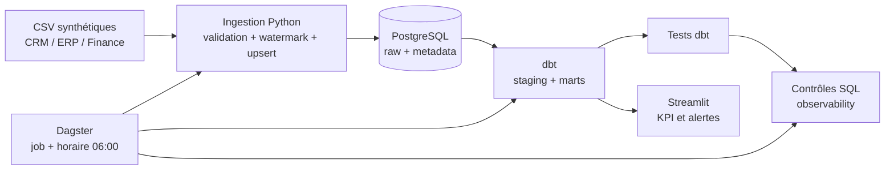

# Architecture

## Vue d'ensemble

## Composants

| Composant | Fichiers | Responsabilité |
|---|---|---|
| Générateur | `scripts/generate_demo_data.py` | crée un scénario synthétique déterministe |
| Ingestion | `src/pme_data_stack/ingestion.py` | contrats de colonnes, conversions, delta et upsert |
| Accès DB | `config.py`, `db.py` | configuration et initialisation des schémas techniques |
| Transformation | `models/staging`, `models/marts` | nettoyage puis tables orientées métier |
| Qualité | `models/*.yml`, `tests_dbt`, `quality.py` | tests structurels, métier et fraîcheur |
| Orchestration | `orchestration/definitions.py` | enchaînement et planification du pipeline |
| Restitution | `dashboard/app.py` | lecture des marts et visualisation |

## Flux d'information

1. Les CSV sont lus suivant les `SourceSpec` : colonnes attendues, types, clé primaire et watermark.
2. PostgreSQL stocke les lignes sources dans `raw` et l'état d'ingestion dans `metadata.ingestion_state`.
3. L'upsert rend le rejeu idempotent. Une ligne n'est sélectionnée que si son `updated_at` est strictement supérieur au watermark.
4. dbt crée cinq vues `staging` puis cinq tables `marts` : `sales_orders`, `sales_daily`, `inventory_status`, `accounts_receivable` et `executive_kpis`.
5. Les tests dbt puis cinq requêtes métier contrôlent les résultats. Ces dernières sont historisées dans `observability.quality_results`.
6. Streamlit lit uniquement les marts et les résultats de qualité.

## Choix et compromis

- **PostgreSQL** : SQL standard, contraintes et compatibilité dbt ; plus lourd que DuckDB pour une simple démo.
- **dbt** : lineage et tests déclaratifs ; ajoute un outil à apprendre.
- **Dagster** : exécutions observables et typées ; surdimensionné pour cinq CSV mais représentatif d'un projet client.
- **Streamlit** : démonstration rapide en Python ; moins adapté qu'une application web dédiée aux besoins UX, RBAC ou multi-tenant.
- **Docker Compose** : environnement reproductible local ; ce n'est ni un orchestrateur de production ni une stratégie de haute disponibilité.

## Dépendances et frontières

Les services communiquent sur le réseau Docker interne. Les trois ports exposés sont liés à `127.0.0.1`. Les identifiants proviennent de `.env`, ignoré par Git. Les dépendances Python sont épinglées dans `requirements.txt` ; Docker est le chemin d'exécution supporté.

Pour exploiter le système, consulter [OPERATIONS.md](OPERATIONS.md). Pour le modèle de menace, consulter [SECURITY.md](SECURITY.md).
