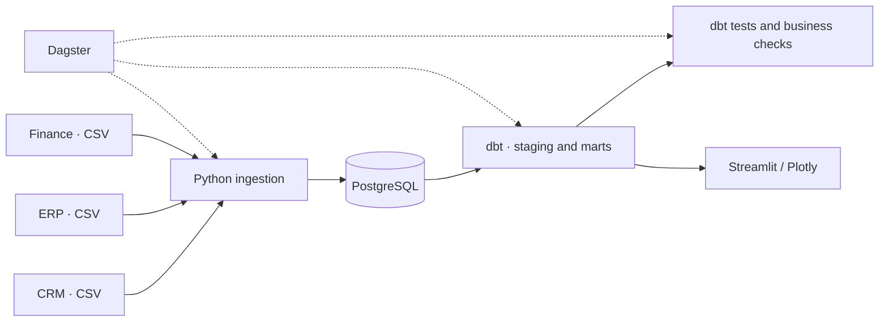

# ORBIT — Data Engineering & Business Intelligence

**Turn fragmented CRM, ERP and finance exports into validated business analytics.**

Orbit is a reproducible portfolio demonstrator for small and medium-sized businesses: incremental Python ingestion, a PostgreSQL warehouse, tested dbt models, Dagster orchestration and a Streamlit dashboard. All business data is synthetic.

[Français](README.fr.md) · [Interactive showcase](https://fadelsantiago.com/apps/orbit) · [Demonstration video](https://fadelsantiago.com/apps/orbit#demonstration) · [GitHub](https://github.com/fadel-santiago/orbit)

[](https://github.com/fadel-santiago/orbit/actions/workflows/ci.yml)


[Overview](#overview) · [Architecture](#architecture) · [Quick start](#quick-start) · [Verification](#verification) · [Documentation](#documentation) · [Limitations](#limitations)

## Overview

Disconnected sales, inventory and accounting exports make reporting difficult to reconcile and trust. Orbit consolidates these sources and checks the resulting metrics before presenting them to decision-makers.

The demonstrator answers five practical questions:

- What revenue and gross margin have been generated?
- Which sales channels and regions contribute to performance?
- Which products need replenishment?
- Which overdue invoices need attention?
- Are the data relationships, amounts and ingestion freshness consistent?

These are demonstrated analytical capabilities, not measured client outcomes or claims of improved productivity.

<a href="docs/screenshots/dashboard1.png"></a>

*Actual application screenshot using synthetic data. The local Streamlit interface is currently in French.*

| Sales performance | Inventory and receivables |
|:---:|:---:|
| [](docs/screenshots/dashboard2.png) | [](docs/screenshots/dashboard3.png) |
| Revenue, gross margin and sales channels. | Low-stock products and invoices requiring follow-up. |

| Data quality | Dagster orchestration |
|:---:|:---:|
| [](docs/screenshots/dashboard4.png) | [](docs/screenshots/dagster-pipeline.png) |
| Recorded integrity and freshness checks. | Observable ingestion, transformation and validation steps. |

The [public showcase](https://fadelsantiago.com/apps/orbit) provides a browser-side interactive demo and the existing walkthrough video. It uses synthetic fixtures and derived calculations; it does **not** execute the local PostgreSQL/dbt/Dagster stack.

## Architecture



| Component | Responsibility |
|:--|:--|
| Synthetic sources | Five CSV files: customers, orders, order lines, inventory and invoices |
| Python | Column contracts, type conversion, per-source watermarks and key-based upserts |
| PostgreSQL 16 | Persistent storage with `raw`, `metadata`, `staging`, `marts` and `observability` schemas |
| dbt | Five staging views, five analytical models and 23 data tests |
| Dagster | Three-step pipeline and a defined daily schedule at 06:00, `Europe/Paris`; enable the schedule explicitly in Dagster |
| Streamlit / Plotly | Sales trends, revenue, margins, inventory alerts, receivables and quality results |
| Docker Compose | Local services, internal networking and named persistence volumes |

Ingestion selects rows with an `updated_at` value **strictly greater** than the source watermark; PostgreSQL upserts them by business key. dbt builds the analytical models and runs tests. Five additional business checks record results and fail the pipeline when a check fails.

In the local dashboard, region and date filters affect sales. Inventory and overdue-invoice indicators remain company-wide; the public showcase has its own explicitly described filter scope.

See [ARCHITECTURE.md](ARCHITECTURE.md) for the detailed design (French).

## Quick start

### Prerequisites

- Git.
- Docker with **Linux containers**: Docker Desktop on macOS/Windows, or Docker Engine on Linux.
- Docker Compose **2.24.0 or newer**. The configuration uses [`env_file.required`](https://docs.docker.com/reference/compose-file/services/#required), which requires this version.
- A POSIX shell and `make` for the Makefile workflow. On Windows, use WSL2 with `make`, or the PowerShell equivalent below.
- Available local ports: `5432`, `3000` and `8501`, or override them in `.env`.
- Network access for initial container-image and Python-package downloads.

No host Python installation is required for the Docker workflow. A native host-Python installation is not the supported setup path.

### macOS, Linux or a Windows WSL2 shell

```bash
git clone https://github.com/fadel-santiago/orbit.git
cd orbit
cp .env.example .env
make demo
make test
```

Create `.env` only if it does not already exist; keep any existing local configuration. Use the supplied credentials exclusively for the synthetic local demo.

`make demo` starts the services, regenerates the deterministic synthetic fixtures at the default reference date `2026-10-11`, and executes ingestion → dbt build/tests → business checks. To deliberately generate another period, use `make demo DEMO_AS_OF=YYYY-MM-DD` on a separate demo environment. Older replacement data can be skipped by an existing watermark.

`make test` runs the four Python tests and then reruns the **write-producing** pipeline. Run it only against the local synthetic database.

### Windows PowerShell equivalent — not runtime-verified

These commands map directly to the existing Makefile and do not require `make`. Enable Docker Desktop's Linux-container backend first. Windows execution was not tested in this batch.

```powershell
git clone https://github.com/fadel-santiago/orbit.git
Set-Location orbit
Copy-Item .env.example .env
docker compose up -d warehouse orchestrator dashboard
docker compose run --rm orchestrator python scripts/generate_demo_data.py --as-of 2026-10-11
docker compose run --rm orchestrator python -m pme_data_stack.cli pipeline
docker compose run --rm orchestrator pytest -q
docker compose run --rm orchestrator python -m pme_data_stack.cli pipeline
```

As above, create `.env` only for a new checkout. If the bind mount is unavailable, check Docker Desktop file-sharing permissions.

### Open the applications

| Service | Default local address | Port override in `.env` |
|:--|:--|:--|
| Streamlit dashboard | http://127.0.0.1:8501 | `DASHBOARD_HOST_PORT` |
| Dagster | http://127.0.0.1:3000 | `DAGSTER_HOST_PORT` |
| PostgreSQL | `127.0.0.1:5432` | `POSTGRES_HOST_PORT` |

Host ports are bound to `127.0.0.1`. Services communicate over the internal Compose network using `warehouse:5432`; keep `POSTGRES_PORT=5432` when changing the **host** port.

### Operate without discarding data

```bash
make pipeline   # Replay ingestion, rebuild dbt models, run business checks
make logs       # Follow service logs
make down       # Stop services; retain named volumes
```

`postgres_data` stores PostgreSQL data; `dagster_data` stores Dagster state. **`make clean-data` / `docker compose down -v` deletes both volumes for the selected Compose project.** Do not run it unless deliberately resetting that synthetic environment.

Changing the checkout directory name or Compose project name can select different volumes. Before moving an existing installation from `mini-data-platform` to `orbit`, retain its previous `COMPOSE_PROJECT_NAME` and verify its volumes; a GitHub rename alone does not migrate local data.

See [OPERATIONS.md](OPERATIONS.md) for detailed procedures (French) and [the portability audit](docs/PORTABILITY_AUDIT.md) for platform-specific limits.

## Verification

**Recorded local pipeline verification: 17 October 2026**, using a clean local clone with isolated Compose project, ports and volumes.

| Check | Recorded result |
|:--|:--|
| Python tests | 4 / 4 passed |
| dbt models built | 10 |
| dbt tests | 23 / 23 passed |
| Business checks | 5 / 5 passed |
| Unchanged ingestion replay | 0 new rows for each of the five sources |
| PostgreSQL persistence | Retained after container recreation without deleting volumes |
| Service access | Healthy PostgreSQL; accessible Streamlit and Dagster |

[GitHub Actions run 38993272997](https://github.com/fadel-santiago/orbit/actions/runs/38993272997) completed successfully on **17 October 2026**, on Ubuntu at commit `575092f`. The workflow runs `make demo` and `make test` on pushes and pull requests to `main`, with isolated project resources and unconditional cleanup.

The fixture contains **16 customers, 84 source orders, 64 invoices and 12 inventory products**; cancelled orders are excluded from sales models. These counts describe synthetic inputs, not client activity or a performance benchmark.

**This documentation audit, 21 October 2026, did not rerun the pipeline, CI or containers.** Prior passes are historical evidence, not a new cross-platform certification. See [CHANGELOG.md](CHANGELOG.md).

| Platform | Evidence and remaining verification |
|:--|:--|
| macOS | Previous local Docker verification is documented; not repeated in this batch |
| Linux | Existing Ubuntu CI passed; other distributions and local Engine configurations are unverified |
| Windows | PowerShell and WSL2 instructions reviewed against the Makefile; execution unverified |
| CPU architectures | No x86-64/ARM64 build-and-run matrix has been verified |

## Project structure

```text
orbit/
├── src/pme_data_stack/   # Ingestion, configuration, database access and quality
├── models/              # dbt staging views and analytical marts
├── macros/              # dbt schema naming
├── orchestration/       # Dagster job and schedule
├── dashboard/           # Streamlit / Plotly application
├── data/sources/        # Five synthetic CSV fixtures
├── tests/               # Python unit tests
├── tests_dbt/           # Custom SQL assertions
├── docs/screenshots/    # Actual application screenshots
├── docker-compose.yml
├── Makefile
└── README.md
```

## Documentation

The entry point is English-first; the following technical guides are currently in French.

| Document | Contents |
|:--|:--|
| [README.fr.md](README.fr.md) | French project overview and original verification narrative |
| [PRODUCT.md](PRODUCT.md) | Business problem, users, requirements and scope |
| [ARCHITECTURE.md](ARCHITECTURE.md) | Components, data flow and design decisions |
| [LEARNING.md](LEARNING.md) | Concepts, reproduction exercises and interview preparation |
| [OPERATIONS.md](OPERATIONS.md) | Setup, operation, maintenance and troubleshooting |
| [SECURITY.md](SECURITY.md) | Security decisions, limitations and deployment precautions |
| [CHANGELOG.md](CHANGELOG.md) | Change history and verification evidence; latest audit entry is in English |
| [PORTFOLIO.md](PORTFOLIO.md) | Technical presentation and demonstration walkthrough |
| [Portability and branding audit](docs/PORTABILITY_AUDIT.md) | English findings, rename-reference inventory and translation priorities |

## Limitations

- This is a **portfolio demonstrator**, not a production-ready platform. No measured business gains or real client outcomes are claimed.
- Exports are local CSV files, not live CRM/ERP connectors. Ingestion reads entire files into memory and uses a strict timestamp watermark: late-arriving rows, same-timestamp corrections and source deletions need a separate reconciliation strategy.
- Fixture generation is deterministic; receivables use PostgreSQL `current_date`, so overdue amounts can differ from older screenshots or the frozen browser-side showcase.
- Dagster runs its development server. A schedule definition is not proof that recurring runs are enabled.
- Application authentication, RBAC, TLS, read-only dashboard database roles, backup/restore, high availability and production monitoring are not implemented or verified.
- Direct Python requirements are pinned, but transitive packages, build tooling and container-image digests are not locked. No current vulnerability assessment is claimed.
- The local UI, log messages and supplementary guides remain mostly French. English application localization is future work.

## License

The GitHub repository publishes an [MIT license](https://github.com/fadel-santiago/orbit/blob/main/LICENSE). The [audit](docs/PORTABILITY_AUDIT.md) records a missing license file in the older local checkout; reconcile that snapshot with the existing remote license before redistributing it. Third-party dependency licenses require separate review.

See [SECURITY.md](SECURITY.md) and [the audit](docs/PORTABILITY_AUDIT.md) before adapting the project for client data.
