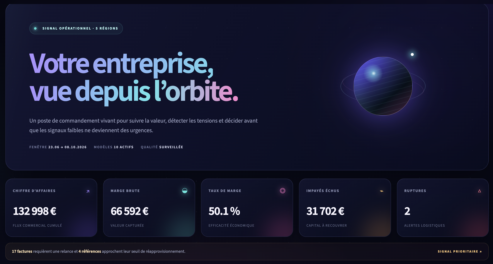
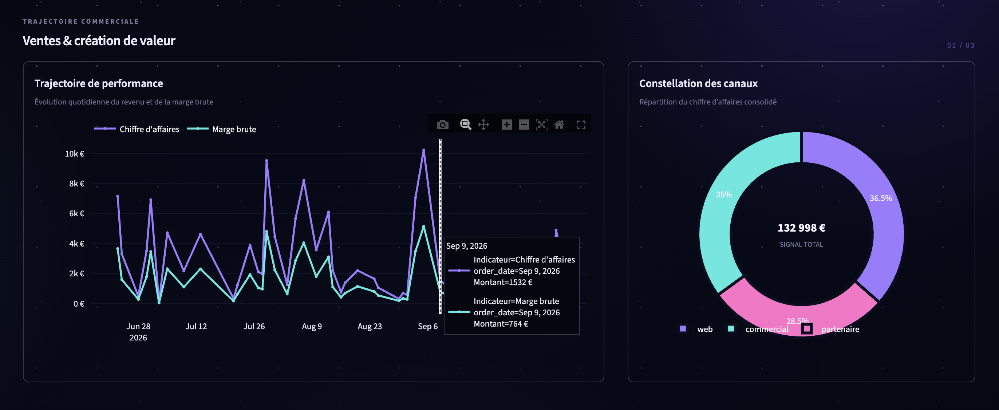
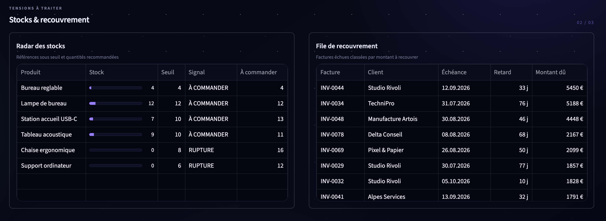
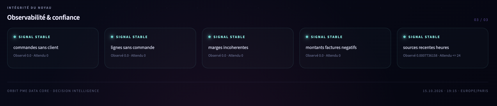
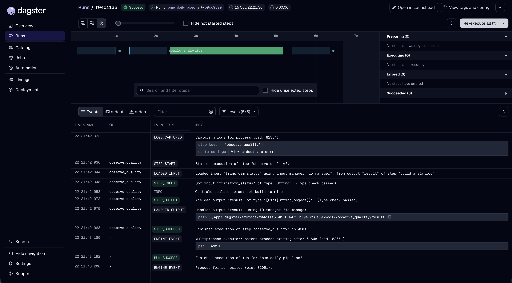
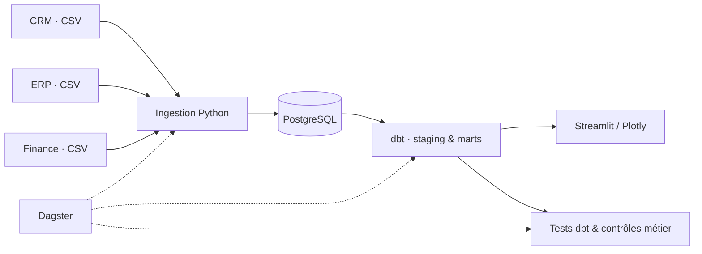

<div align="center">

# ORBIT

### PME Data Core · Mini-plateforme Data Engineering & BI

**Des sources dispersées à des indicateurs cohérents, contrôlés et exploitables.**

Démonstrateur de bout en bout : **ingestion incrémentale**, **modélisation analytique**, **tests de qualité**, **orchestration** et **visualisation métier** — entièrement exécutable en local avec des données synthétiques.

<p>
  
  
  
  
  
  
</p>

<p>
  
  
  
  
</p>

[**Aperçu**](#aperçu) · [**Architecture**](#architecture) · [**Démarrage**](#démarrage-rapide) · [**Vérification**](#vérification) · [**Documentation**](#documentation)

</div>

---

## Aperçu

**Orbit** réunit des données issues de systèmes CRM, ERP et finance dans une base analytique commune. Le tableau de bord met en évidence la performance commerciale, les risques de rupture de stock, les factures échues et l'état des contrôles de qualité.

<a href="docs/screenshots/dashboard1.png">
  
</a>

<sub>Vue d'ensemble — indicateurs et alertes opérationnelles. Les chiffres affichés proviennent de données de démonstration synthétiques.</sub>

### Explorer le dashboard

| Performance commerciale | Stocks & recouvrement |
|:---:|:---:|
| <a href="docs/screenshots/dashboard2.png"></a> | <a href="docs/screenshots/dashboard3.png"></a> |
| Courbes de ventes et marge, répartition par canal. | Articles à réapprovisionner et factures à relancer. |

| Qualité & observabilité | Orchestration Dagster |
|:---:|:---:|
| <a href="docs/screenshots/dashboard4.png"></a> | <a href="docs/screenshots/dagster-pipeline.png"></a> |
| Suivi des contrôles métier et de la fraîcheur des données. | Exécution vérifiable du pipeline de traitement. |

## Pourquoi ce projet ?

Dans une PME, les données de vente, de stock et de facturation peuvent être réparties entre plusieurs exports. Leur rapprochement manuel complique l'analyse et peut produire des KPI incohérents.

Orbit illustre une approche reproductible pour répondre à cinq questions :

1. Quel chiffre d'affaires et quelle marge ont été générés ?
2. Quels canaux et quelles régions contribuent aux ventes ?
3. Quels produits sont sous leur seuil de stock ?
4. Quelles factures échues nécessitent une relance ?
5. Les données utilisées sont-elles cohérentes et suffisamment récentes ?

## Architecture



| Composant | Rôle dans le démonstrateur |
|:--|:--|
| **Sources** | 5 CSV synthétiques provenant des domaines CRM, ERP et finance |
| **Python** | Contrats de colonnes, ingestion incrémentale, *watermarks* et *upserts* idempotents |
| **PostgreSQL** | Stockage et séparation logique des couches `raw`, `metadata`, `staging`, `marts` et `observability` |
| **dbt** | 5 vues de *staging*, 5 modèles métier et 23 tests |
| **Dagster** | Orchestration du pipeline et planification quotidienne à 06:00 (`Europe/Paris`) |
| **Streamlit + Plotly** | Exploration des KPI, analyses commerciales, suivi des stocks, facturation et qualité |
| **Docker Compose** | Exécution locale et reproductible des services |

Pour le détail des composants, flux et compromis techniques, voir [ARCHITECTURE.md](ARCHITECTURE.md).

## Démarrage rapide

### Prérequis

- Docker Desktop avec Docker Compose.
- Un terminal avec `make` disponible.

À la racine du dépôt :

```bash
cp .env.example .env
make demo
```

Le scénario synthétique est régénéré à une date de référence fixe afin que cette commande ne modifie pas les fixtures versionnées. Une autre date peut être testée explicitement avec `make demo DEMO_AS_OF=YYYY-MM-DD`.

| Service | Adresse locale |
|:--|:--|
| **Orbit · Dashboard** | http://127.0.0.1:8501 |
| **Dagster · Orchestration** | http://127.0.0.1:3000 |
| **PostgreSQL** | `127.0.0.1:5432` |

Les services sont liés à `127.0.0.1`. Les identifiants d'exemple sont réservés à la démonstration locale sur données synthétiques. Si ces ports sont déjà occupés, consulter [OPERATIONS.md](OPERATIONS.md) et la configuration Compose.

## Vérification

Lancer la suite de tests :

```bash
make test
```

**Dernière vérification rapportée : 17 octobre 2026** — clone local propre, projet Compose et volumes isolés.

| Vérification | Résultat observé |
|:--|--:|
| Tests Python (`pytest`) | **4 / 4** réussis |
| Modèles dbt construits | **10** |
| Tests dbt | **23 / 23** réussis |
| Contrôles métier | **5 / 5** réussis |
| Seconde ingestion des mêmes sources | **0** nouvelle ligne |
| État des services | PostgreSQL sain, Streamlit et Dagster accessibles |

**Jeu de données synthétique utilisé :** 16 clients, 84 commandes, 64 factures et 12 références produit. Ces volumes décrivent le jeu de démonstration, pas une activité réelle ni un benchmark de performance.

Les résultats et limites de vérification sont consignés dans [CHANGELOG.md](CHANGELOG.md).

## Structure du projet

```text
mini-data-platform/
├── src/pme_data_stack/   # ingestion, configuration, accès BD et qualité
├── models/               # modèles dbt : staging et marts
├── macros/               # macros dbt
├── orchestration/        # définitions Dagster
├── dashboard/            # interface Streamlit / Plotly
├── data/sources/         # jeux CSV synthétiques
├── tests/                # tests Python
├── tests_dbt/            # assertions métier SQL
├── docs/screenshots/     # visuels du démonstrateur
├── docker-compose.yml
├── Makefile
└── README.md
```

## Documentation

| Document | Contenu |
|:--|:--|
| [PRODUCT.md](PRODUCT.md) | Périmètre fonctionnel, utilisateurs et exigences métier |
| [ARCHITECTURE.md](ARCHITECTURE.md) | Architecture, flux de données et décisions techniques |
| [LEARNING.md](LEARNING.md) | Explications des concepts et parcours de reproduction |
| [OPERATIONS.md](OPERATIONS.md) | Installation, commandes, maintenance et dépannage |
| [SECURITY.md](SECURITY.md) | Mesures de sécurité, menaces et exigences avant production |
| [CHANGELOG.md](CHANGELOG.md) | Historique des changements et résultats de vérification |
| [PORTFOLIO.md](PORTFOLIO.md) | Présentation et parcours de démonstration techniques |

## Périmètre et limites

> [!IMPORTANT]
> **Projet de portfolio, non destiné à la production en l'état.** Toutes les données métier affichées sont synthétiques. Aucun résultat client ni gain de productivité réel n'est revendiqué.

Le démonstrateur utilise des exports locaux et une seule machine. Avant un usage en production, il faudrait notamment traiter l'authentification, les rôles et permissions, TLS, les sauvegardes, la supervision et les alertes, la CI/CD, les connecteurs réels et les exigences de disponibilité.

---

<div align="center">
  <sub><strong>ORBIT · PME Data Core</strong> — Démonstration de Data Engineering, qualité des données et Business Intelligence.</sub>
</div>
